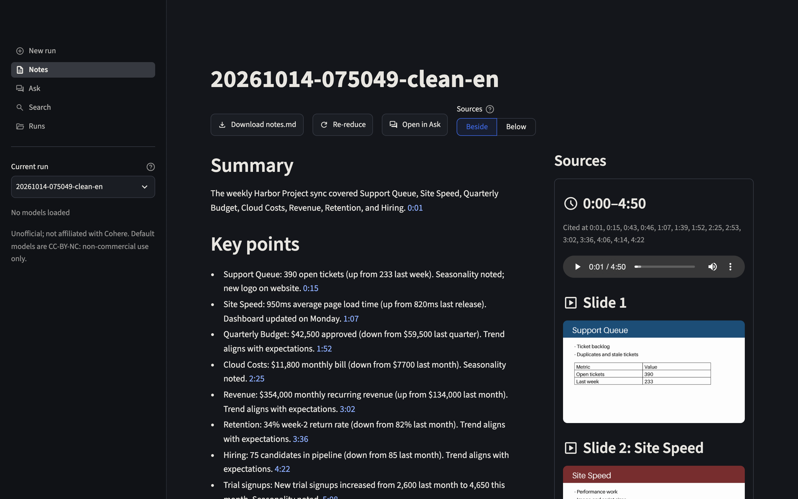
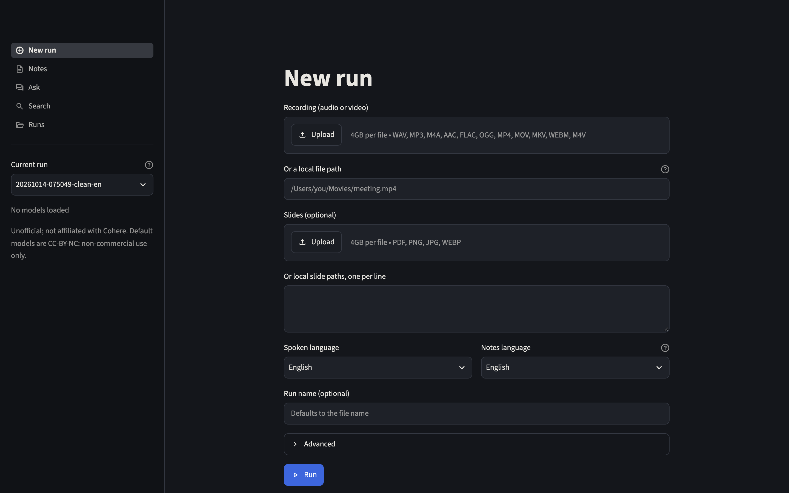
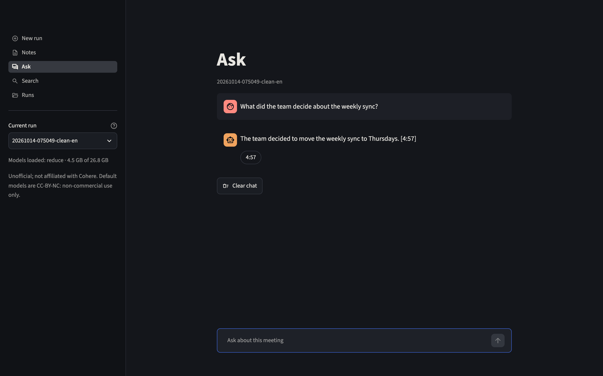
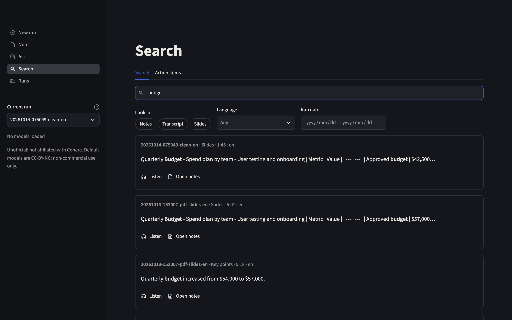

# cohr
Local, offline meeting notes for Apple Silicon. A recording plus slides (or a screen-recording
video) becomes notes in which every claim cites its timestamp `[mm:ss]` or `[slide N]`. All
models run on MLX; nothing leaves your machine.

*Independent project. Not affiliated with or endorsed by Cohere.*



- **Recordings** in 14 languages (Cohere Transcribe's).
- **Notes** in Command R7B's 23 languages, plus "Other (beta)" languages translated by Tiny Aya.
- **Ask** questions about a meeting and **search** across all of them, with citations.
- **Checked against the meeting**: numbers, dates, owners and due dates in the notes are
  compared with the transcript and slides; uncited claims are flagged, never given a citation.

Current release: **v1.11.0**. What each release changed:
[GitHub releases](https://github.com/darylalim/cohr/releases). Design: `PLAN.md`; progress:
`NOTES.md`.

## Requirements
- **Hardware**: Apple Silicon Mac.
- **Software**: Python 3.13, [uv](https://docs.astral.sh/uv/), and `ffmpeg` on `PATH`
  (`brew install ffmpeg`).
- **Memory**: the default `resident` policy keeps each model loaded once it's used (peak
  ~17 GB, for 32 GB Macs). On a 16 GB Mac, choose `sequential` as the Memory policy on the
  New run page: it loads one model at a time (peak ~6 GB) and writes the same notes.
- **Disk**: ~14.4 GB for the models, plus each run's media until you prune it.
- **Speed** (M2 Max, 32 GB): about 6 minutes per hour of audio; slides add the Vision stage.

## Setup
```sh
uv sync
uv run cohr models download   # the five pipeline models at pinned revisions (~14.4 GB)
uv run cohr models            # what's downloaded, with sizes
```
`cohr models download` checks free space first, and resumes an interrupted download when run
again. Models go to the Hugging Face cache (`~/.cache/huggingface/hub`), or to
`$COHR_HF_HOME/hub` when that's set. Only `cohr models download` uses the network; runs never
do.

## App
```sh
uv run streamlit run app.py
```
- **New run**: upload or link a recording and slides, and pick the languages.
- **Notes**: the cited notes, with a Sources panel of the audio and slides.
- **Ask**: questions about a run, answered with citations.
- **Search**: words, names and numbers across every run's transcript, slides and notes, and
  every meeting's action items by owner.
- **Runs**: status and size of each run; prune or delete it.

| New run | Ask | Search |
| --- | --- | --- |
|  |  |  |

Screenshots show the eval set's generated meetings (`evals/gen`), not real recordings.

## Command line
```sh
uv run cohr run meeting.m4a --slides deck.pdf --target de   # create runs/<id>/ and process it
uv run cohr run --video screen.mp4 --lang es                 # slides from the video's frames
uv run cohr runs                                             # list runs with size and status
uv run cohr resume <run>                                     # re-run from the first incomplete stage
uv run cohr prune <run>                                      # drop media, keep notes and JSON
uv run cohr rm <run>                                         # delete a run
uv run cohr search "budget" --kind note                      # search every run
uv run cohr index rebuild                                    # rebuild runs/index.db
```
`--lang` is the meeting's language and `--target` the notes' (both default to `en`).

The search index (`runs/index.db`) is rebuilt from the run files whenever it's missing or out
of date, so deleting it is always safe.

| Setting | Default | Meaning |
| --- | --- | --- |
| `COHR_RUNS_DIR` | `./runs` | where runs are stored |
| `COHR_HF_HOME` | Hugging Face's cache | where models are stored (`$COHR_HF_HOME/hub`) |

## Deleting models
`uv run cohr models` lists the five model repos. Remove one with `hf cache rm` (it ships with
huggingface_hub; add `--cache-dir "$COHR_HF_HOME/hub"` if you set `COHR_HF_HOME`). Run it with
`--dry-run` first:
```sh
uv run hf cache rm model/mlx-community/c4ai-command-r7b-12-2024-4bit --dry-run
uv run hf cache rm model/mlx-community/c4ai-command-r7b-12-2024-4bit
```
`cohr models download` fetches anything removed.

> [!WARNING]
> Don't use `hf cache prune`: it removes revisions that no branch points to, and cohr pins
> exactly such revisions, so it deletes cohr's models (R7B, Tiny Aya, North Micro Vision and
> the judge). If you use it for other caches, run `hf cache prune --dry-run` first.

## Evals
Quality is measured on meetings with known facts (`evals/README.md`, PLAN §18):

| Set | What it covers | Time |
| --- | --- | --- |
| `quick` | four 5-minute English meetings: clean, noisy, PDF deck, misspoken number | ~10 min |
| `lang` | notes in German, Arabic, Hindi, Swahili and Bengali; Spanish and Japanese meetings | ~10 min |
| `long` | one 2.5-hour meeting: two-pass notes and Ask at scale | ~1 h |
| `full` | `quick` + `lang` + FLEURS clips in 14 languages + 5 real AMI meetings; the release check | ~1 h |

## License
Three layers, with separate licenses:
- **This project's code**: Apache-2.0 (`LICENSE`, `NOTICE`).
- **Model weights**: downloaded at runtime, never redistributed, and governed by their
  authors' licenses. Cohere Transcribe and North Micro Vision are Apache-2.0, Silero VAD is
  MIT, and Tiny Aya Global and Command R7B are **CC-BY-NC-4.0**. With the default models, the
  app is for personal and research use only.
- **Eval data** (`full` only; fetched at eval time, never committed): AMI Meeting Corpus
  (University of Edinburgh et al.) and FLEURS (Google), both CC BY 4.0.
